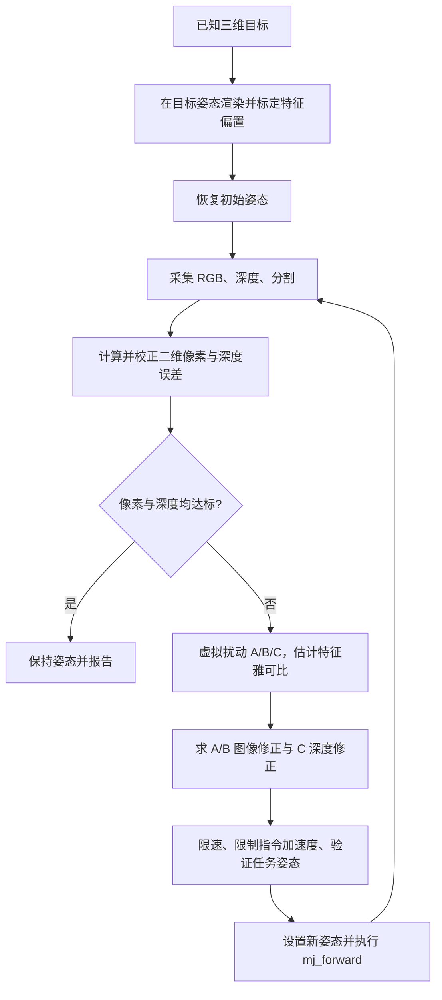

# 视觉伺服使用与研究笔记

## 当前实现补充（2026-10-22）

本节描述当前默认 `geometry` 模式。下方自“2026-10-16 历史研究记录”起保留当时的 `image_depth` 实现、参数和实验，不作为当前默认行为说明；其中旧分辨率、逐目标姿态标定及停止阈值不能直接套用于新模式。

当前相机实际渲染为 1920×1440，测量使用 RGB、仿真分割和深度。固定相机内外参、RCM 和针具长度/半径是标定输入。可见针杆圆柱多点约束针轴，可见实体端面或真正 apex 小球约束轴向位置，重建物理尖端；看不到这些约束时明确失败，不使用可见锥面单像素替代尖端。目标由当前标靶球面深度拟合得到。测量器只读图像数组和标定数据，不读动态针尖/目标真值，也不在已知目标姿态渲染特征偏置。

几何反馈使用归一化的完整三轴 Jacobian 将测得的三维误差映射成轴指令，模型导数用于执行映射；误差本身来自视觉测量。接近阶段限速、限加速度并减速。默认测量误差阈值 8 μm，连续三帧达标且指令速度为零才停止；之后使用独立 MuJoCo 针尖真值按 <20 μm 验收。固定方向 C-only 阶段只按可控方向判断测量收敛，独立验收仍检查完整三维终点。失败保持是有记录的仿真中止，不能解释为实机受约束制动。

```bash
python run_visual_servo.py --no-viewer --output-dir runs/geometry_navigation
python verify_visual_geometry.py --output-dir runs/geometry_checks
python verify_visual_geometry_direction.py
python verify_visual_motion.py
python verify_visual_servo.py --output-dir runs/visual_checks
python verify_vision_navigation.py --output-dir runs/vision_checks
```

在云端使用已配置的 EGL 离屏渲染。几何测试覆盖代表姿态、旧假成功姿态、缺失支持、轴向/方向退化及动态图像因果性；运动测试检查耦合求解、连续停稳和失败路径。各次导航的精度、失败原因和速率以其报告为准，不能由短测试推出全部目标或真实器械均达到20 μm。

`navigation.visual_servo.position_feedback="image_depth"` 保留历史分区图像/深度路径；其标定开关与像素/深度阈值仅在该模式生效。默认 `geometry` 强制不使用目标姿态特征标定。多目标眼底回撤/转移仍按已知目标构造解析轨迹，最后 C 轴接近才使用视觉闭环；这与单目标全程视觉接近、受限制的 `--strict-visual` 入口应分别报告。本项目尚无驱动器动力学、真实 OCT/相机噪声或组织接触验证。

## 2026-10-16 历史研究记录

日期：2026-10-16。对象：本目录当前代码和配置。本文包含代码核对、实际复现、参数对比和定向文献调研；不代表完整系统综述或实机验证。

## 1. 当前系统是什么

当前方法是固定眼内相机下的分区视觉伺服：A/B 根据二维图像误差改变针轴朝向，C 根据渲染深度误差改变插入深度。三轴在同一循环中更新，RCM 由模型的关节参数化保持。

它使用图像反馈，但依赖仿真分割、仿真深度和已知目标姿态的特征标定。比较准确的描述是“图像与深度反馈的 RCM 运动学仿真闭环”。它没有驱动器动力学、真实相机噪声、组织接触和实际编码器闭环。

观察窗口的自由相机与控制相机是两个概念：鼠标拖动或按 F/V 只改变观察视角；控制仍由 `eye_internal` 完成。这里相机相对眼球场景固定，不随针具运动；不能直接照搬移动相机的控制符号和坐标变换。

## 2. 直接运行

在项目根目录打开 PowerShell：

```powershell
cd .\rcm_mujoco_reference
.\.venv\Scripts\python.exe run_visual_servo.py --camera free --output-dir runs/历史记录/04_sessions/demos/visual_learning_01
```

默认目标为眼底路径点 P3，机器人坐标约为 `[1.92,8.478,22.043]` mm，程序从当前默认零位开始。原深部示例 `[9.5,-1.5,16]` mm 仍可通过命令行显式指定。右下角是眼内控制画面，青色十字为目标、绿色十字为针尖、白线为原始图像特征连线；左上角显示校正后的误差及 A/B/C。

- F：自由/固定观察相机切换。
- V：循环固定观察相机。
- 自由视角：左拖旋转、右拖平移、滚轮缩放。
- 控制完成后保持最终姿态，关闭窗口后保存报告并结束。
- 当前视觉入口没有实现 P 暂停键；不要套用坐标导航入口的按键说明。
- 当前控制循环没有把关闭窗口实现成可靠的取消流程，不能依赖提前关窗完成受控停止。本文未修改此行为。

无窗口运行和正式验证：

```powershell
.\.venv\Scripts\python.exe run_visual_servo.py --no-viewer --output-dir runs/历史记录/04_sessions/demos/visual_learning_02
.\.venv\Scripts\python.exe verify_visual_servo.py --output-dir runs/历史记录/04_sessions/demos/visual_learning_verify_01
```

`verify_visual_servo.py` 除了视觉收敛，还检查三维终点误差不超过 150 μm，以及轨迹指令速度/加速度约束。`run_visual_servo.py` 的 `PASS` 本身主要表示视觉误差进入阈值，不能替代这些验收断言。

修改目标：

```powershell
.\.venv\Scripts\python.exe run_visual_servo.py --target-robot 9.5 -1.5 16 --camera eye_internal --output-dir runs/历史记录/04_sessions/demos/visual_learning_03
```

支持 `--target-world`，但一次只使用一种坐标参数。输入长度单位 mm；内部任务姿态使用 rad、rad、m。当前视觉入口没有 `--targets` 批处理，也没有自动退针回零流程。

修改目标并不会自动将配置中的 `reference_scene.eye_camera.target_robot_mm` 改成新目标；控制相机朝向是独立设置。新目标可能在运动学上可达，却不在相机有效视场内。坐标导航的 `--solve-only` 可以辅助检查几何可达性，但不能证明视觉伺服可收敛。

每次使用新的输出目录，避免覆盖上次实验。输出包括：

| 文件 | 用途 |
|---|---|
| `visual_servo_report.json` | 结束原因、最终误差、特征偏置、速率约束检查 |
| `visual_servo.csv` | 每次观测的图像/深度/三维误差、关节姿态和指令 |
| `camera_0000.png`、`camera_final.png` | 初始、最终原始相机图像 |
| `guidance_0000.png`、`guidance_final.png` | 叠加特征位置和误差连线的图像 |

## 3. 一次闭环究竟做了什么



### 3.1 观测来源

`VisualServoSensor.observe()` 的数据来源并不相同：

| 量 | 当前获取方法 | 实际使用的理想条件 |
|---|---|---|
| 目标像素中心 | RGB 阈值掩膜的质心 | 橙色标靶、背景简单、颜色稳定 |
| 针尖像素中心 | 指定 MuJoCo geom 的分割掩膜质心 | 已知几何体 ID 和专用标记 |
| 目标深度 | 标靶几何分割范围内深度中位数 | 渲染器直接提供深度与对象身份 |
| 针尖深度 | 针尖标记范围内深度中位数 | 同上 |

标靶只保留一个中心球，不再用外围球维持目标可见；针尖另有半径 0.22 mm 的可视标记。针尖遮住中心球时，目标会从图像中消失。传感器渲染隐藏眼球外壳和相机标记，显示专用针尖标记。因此，当前黑色背景的控制图像不是逼真的眼底图像，目标完全遮挡后的恢复也尚未实现。

### 3.2 误差与特征偏置

设针尖像素为 `(u_t,v_t)`，目标像素为 `(u_g,v_g)`，深度为 `Z_t,Z_g`：

```text
e_raw = [u_t-u_g, v_t-v_g, 1000*(Z_t-Z_g)]
e = e_raw - b
```

前两项单位像素，最后一项单位 mm。这里深度是渲染相机提供的深度，不是 C 轴位移，也不是针尖到 RCM 的距离。

`b` 的获取方式非常重要：程序先通过已知三维目标求出目标关节姿态，临时将模型放到该姿态，渲染并记录此时的 `e_raw`，然后恢复真实起始姿态。这补偿了有限标记尺寸、可见表面、遮挡、透视和像素离散导致的偏差。

所以 `ground_truth_used_for_stop=false` 仅表示循环停止判断不直接使用三维针尖距离；不能据此说整个系统没有使用目标真值。目标姿态参与了启动标定。

默认复现的偏置为 `[0.6111 px, -1.2222 px, -0.10227 mm]`。最终校正误差为 `[0.3889 px, 0 px, -0.03990 mm]`。这解释了为何原始十字不必完全重合，也可能满足当前停止条件。

### 3.3 雅可比：把“误差”换成“怎么动”

内部任务变量 `q=[A_rad,B_rad,C_m]`。程序对三个轴分别做有限差分：

```text
J[:,i] ≈ (e(q + h_i) - e(q)) / h_i
```

优先正向探测；遇到不可见或无效姿态时尝试反向，然后恢复原姿态。没有实际运行这些探测动作的运动过程，也不把它们计入执行轨迹。

完整 J 是 3×3，但当前控制器只使用：

- `J_AB=J[:2,:2]`：A/B 对二维像素误差的影响。
- `j_C=J[2,2]`：C 对深度误差的影响。

每次更新为：

```text
Δq_AB = -k J_ABᵀ (J_AB J_ABᵀ + λ²I)⁻¹ e_uv
Δq_C  = -k e_depth / j_C
```

`k` 是 `step_gain`，`λ` 是 `damping`。A/B 使用阻尼最小二乘，C 使用一维局部增益。当前实现没有将 A/B 对深度、C 对像素的耦合项同时纳入求解；连续重观测会修正部分耦合误差，但这不是全局收敛保证。

注意这里求的是每次迭代的位置增量，再除以 `dt` 得到期望速度。与连续时间文献中的 `q_dot=-k J⁺e` 比较时，必须同时说明采样周期和增益定义，不能直接比较 k 的数字。

当前代码在 `J_AB` 秩不足 2 时直接退出，即使有阻尼也不会继续求解。实际机器人无法通过瞬间改变并恢复真实关节来“免费”获取雅可比；迁移时需要标定模型、受控辨识动作或在线估计。

### 3.4 指令更新与停止

```text
v_wanted = clip(Δq/dt, -v_max, v_max)
v = clip(v_wanted, v_previous-a_max*dt, v_previous+a_max*dt)
q_next = q + v*dt
```

随后 `validate_task()` 检查连杆数学有效性及可选位置约束，`set_task()` 写入姿态并调用 `mj_forward`，同时将 MuJoCo 的 `qvel` 清零。日志中的速度与加速度是离散指令序列的量，不是驱动器实际跟踪测量。

停止条件为校正后的像素误差范数 ≤0.5 px 且深度误差绝对值 ≤0.05 mm。两者需要同时满足。三维针尖误差用于独立验收。

当前停止判断不要求速度接近零，也没有专门的减速停止阶段。本次默认实验停止前最后一条 C 速度指令仍约 0.479 mm/s，因此“速率检查通过”不能解释为完整验证了末端制动过程。

## 4. 当前有效参数

参数来自 `config.json -> navigation.visual_servo`，会覆盖 Python 中的 `DEFAULT_SERVO`。不要只看默认字典判断实际运行值。

| 参数 | 当前值 | 解释 |
|---|---:|---|
| `pixel_tolerance` | 0.5 px | 二维误差范数阈值 |
| `depth_tolerance_mm` | 0.05 mm | 深度误差阈值 |
| `step_gain` | 0.65 | 每轮局部修正比例 |
| `finite_difference_A_deg` / `B_deg` | 0.5° / 0.5° | 雅可比角度探测幅度 |
| `finite_difference_C_mm` | 0.05 mm | 深度方向探测幅度 |
| `damping` | 0.02 | A/B 阻尼求解系数 |
| `sample_period_s` | 0.1 s | 离散指令时间步长 |
| `max_iterations` | 400 | 最大观测轮数 |
| 相机分辨率 / 垂直视场角 | 640×480 / 100° | 影响视场与像素敏感度 |
| A/B/C 最大速度 | 4°/s、2°/s、0.6 mm/s | 来自外层 `navigation` 配置 |
| A/B/C 最大加速度 | 10°/s²、5°/s²、1.5 mm/s² | 同上 |

`target_depth_weight=0.35` 虽存在配置中，但当前控制更新未使用它，修改它不会按名称预期改变控制。`endpoint_tolerance_um` 在控制器中也不是三维误差停止判据，验收脚本另行检查 150 μm。

`time_s=iteration*dt` 是名义控制时间。渲染、雅可比探测、写图像和窗口刷新消耗真实时间；GUI 每轮还有 `sleep(0.04)`。不能把配置 0.1 s 当作系统已经实现了稳定 10 Hz 的实时调度。

## 5. 本次实际复现与参数对比

环境：Windows、Python 3.11.0、MuJoCo 3.3.7；同一默认目标、同一初始零位。未修改原控制器或 `config.json`。

| 条件 | 结果 | 观测次数 | 最后观测名义时间 | 三维终点误差 |
|---|---|---:|---:|---:|
| 当前配置：k=0.65，A/B 探测 0.5° | PASS | 246 | 24.5 s | 81.51 μm |
| 仅将 A/B 探测改为 0.05° | FAIL：雅可比奇异 | 116 | 11.5 s | 7868.37 μm |
| 仅将 k 改为 0.3 | PASS | 248 | 24.7 s | 57.38 μm |

三个实验的已记录指令速率检查均通过。只有默认条件还执行了原始 `verify_visual_servo.py` 的整套断言；另外两组由研究脚本单独记录视觉结果、三维终点是否 ≤150 μm 及速率检查。

### 5.1 画面重合不等于三维到达

默认轨迹中：

| 名义时间 | 像素误差 | 校正深度误差 | 三维针尖误差 |
|---|---:|---:|---:|
| 0 s | 160.788 px | -15.355 mm | 15.589 mm |
| 10 s | 0.488 px | -8.725 mm | 8.769 mm |
| 20 s | 0.354 px | -2.735 mm | 2.759 mm |
| 24.5 s | 0.389 px | -0.03990 mm | 0.08151 mm |

单个二维点只给两个独立标量约束。对于一般三自由度针尖定位，仅靠点的像素重合不能唯一判断深度；需要深度观测或额外几何/运动信息。

当前 C 最大速度 0.6 mm/s，而目标相对进针约 14.668 mm，仅按速度估算就需约 24.45 s，尚未计入启动加速等过程。该目标的大部分过程受 C 速度饱和影响，因此调小增益并不必然显著增加总名义时间。

### 5.2 为什么更小的探测步长反而失败

在失败姿态重新独立测量，0.05° 探测得到：

```text
J_AB ≈ [[-36.692, 0],
        [703.731, 0]]  pixel/rad
rank = 1
```

保持同一姿态改用 0.5°，得到：

```text
J_AB ≈ [[-198.080, 323.039],
        [ 241.414,  -4.140]]  pixel/rad
rank = 2
```

小扰动下 B 轴的渲染像素质心未改变，有限差分得到零列。这是当前图像特征离散化下的数值可观测性问题，不足以判定机械结构在该位置真正奇异。

步长选择需要兼顾：过小看不到像素变化，过大会破坏局部线性近似或导致遮挡。可研究自适应扰动幅度、亚像素定位、中心差分和在线雅可比估计，而不能简单断言“步长越小越准确”。

### 5.3 如何复现实验

```powershell
.\.venv\Scripts\python.exe research/visual_servo/run_parameter_study.py
```

脚本自动创建新的带时间戳目录，只覆盖内存中的实验设置，不修改全局配置。每组保存基础配置、有效视觉参数、图像、CSV 和报告。`effective_servo_settings.json` 是该组实际使用的视觉参数；`effective_config.json` 保存未应用该组覆盖项的基础项目配置。

本次产物：

- [默认验证报告](runs/历史记录/03_studies/visual_servo_study_20261016/baseline/visual_servo_verification.json)
- [默认轨迹 CSV](runs/历史记录/03_studies/visual_servo_study_20261016/baseline/visual_servo.csv)
- [默认最终引导图](runs/历史记录/03_studies/visual_servo_study_20261016/baseline/guidance_final.png)
- [参数对比汇总](runs/历史记录/03_studies/visual_servo_study_20261016/parameters/parameter_summary.json)
- [复现实验脚本](research/visual_servo/run_parameter_study.py)

这是单目标确定性对比，未统计多目标成功率，也未证明 k=0.3 全局更优。

## 6. 论文调研：建议按问题阅读

检索日期 2026-10-16。经典教程的题名、年份、DOI 经 Crossref 核对；眼科论文及综述经 Europe PMC 检索。下表明确区分全文相关段落与摘要，避免将摘要调研表述为全文复现。

| 阅读顺序 | 文献 | 核对范围 | 对本项目的作用 |
|---|---|---|---|
| 1 | Chaumette & Hutchinson, 2006, *Visual servo control. I. Basic approaches*, [DOI](https://doi.org/10.1109/MRA.2006.250573) | 书目信息；建议精读原文 | 理解 IBVS/PBVS、交互矩阵、误差与局部收敛 |
| 2 | Chaumette & Hutchinson, 2007, *Visual servo control. II. Advanced approaches*, [DOI](https://doi.org/10.1109/MRA.2007.339609) | 书目信息；建议精读原文 | 建立分区/混合控制、约束与高级方法的阅读框架 |
| 3 | Yang et al., 2018, *Techniques for robot-aided intraocular surgery using monocular vision*, [全文入口](https://pmc.ncbi.nlm.nih.gov/articles/PMC6366647/)，[DOI](https://doi.org/10.1177/0278364918778352) | 摘要 | 单目眼内成像、结构光表面重建及分区视觉伺服；关注完整眼球中的光学问题 |
| 4 | Huber et al., 2021, *Homography-based Visual Servoing with Remote Center of Motion for Semi-autonomous Robotic Endoscope Manipulation*, [全文](https://pmc.ncbi.nlm.nih.gov/articles/PMC7616652/)，[DOI](https://doi.org/10.1109/ISMR48346.2021.9661563) | 全文方法、标定、结果及结论相关段落 | 学习复合雅可比如何同时处理视觉与 RCM 目标；对象是内窥镜视图控制，不能直接替代眼内针尖定位 |
| 5 | Kim et al., 2024, *Towards Autonomous Retinal Microsurgery Using RGB-D Images*, [全文入口](https://pmc.ncbi.nlm.nih.gov/articles/PMC11415253/)，[DOI](https://doi.org/10.1109/LRA.2024.3368192) | 摘要；全文接口返回 500/429，未完成全文精读 | 显微镜图像与 OCT 融合、工具/组织分割、带运动学约束的 MPC；最贴近后续视网膜下注射研究 |
| 6 | Ma et al., 2025, *Robotics and optical coherence tomography: current works and future perspectives*, [全文](https://pmc.ncbi.nlm.nih.gov/articles/PMC11828438/)，[DOI](https://doi.org/10.1364/BOE.547943) | 全文结构及工具跟踪、OCT 控制、集成相关段落 | 了解深度观测、工具到组织距离、折射校正、配准与延迟处理路线 |

几条与本项目直接相关的研究判断：

1. “图像控制 A/B、深度控制 C”有清晰的分区视觉伺服动机，但本项目的具体解耦是假设，值得与完整 3×3 耦合控制比较。
2. 单目并不等于完全无法估计深度：已知几何、多帧运动、结构光等都可补充信息。但不能仅凭针尖和目标两个二维质心的重合解决深度。
3. RGB-D 眼科研究中的深度常来自 OCT 等专用成像，不宜直接等同于普通消费级深度相机。
4. 机械/模型 RCM 与软件 RCM 不同。当前参数化已约束针轴经过固定点；若实机入口相对机器人发生位移，视觉针尖到达不自动保证实际入口保持不动。
5. Huber 等人的方法虽然强调不依赖显式深度进行视图伺服，全文仍包含相机、手眼和 RCM 初始化步骤；不能把“无需显式深度”解读为“无需任何标定”。
6. Kim 等人 2024 年摘要报告在猪眼上完成 30 次 SI 试验；其任务、传感器和评价对象与本仿真不同，不能直接拿终点误差数字作等条件性能比较。

## 7. 建议的研究实验顺序

以下为后续设计，尚未实施；先保持现有默认配置作为可复现基线。

### 阶段 A：弄清收敛范围

在固定相机下设置覆盖不同方向、深度和初始姿态的目标集。先报告运动学可达、初始可见、标定可见、控制成功四个不同数量，避免只保留成功样本。

比较 k∈{0.3,0.65}、A/B 探测步长∈{0.05°,0.1°,0.5°,1°}。先用开发集选择参数，再在独立目标集评估。确定性场景重复同一目标并不能提供独立统计证据；有噪声实验需要固定并记录多个随机种子。

至少报告：成功率、失败原因、像素/深度误差、三维误差分布、名义收敛时间、实际计算耗时、J_AB 最小奇异值、目标/针尖可见像素数、指令饱和比例、RCM 偏差和针具入眼几何。

### 阶段 B：验证哪些理想条件是必需的

分别引入像素定位噪声、深度偏置、图像延迟、局部遮挡、相机安装误差；每次先改变一个因素，再做组合扰动。比较三种期望特征来源：当前逐目标真值标定、独立标定集得到的偏置、外部给定期望图像/深度。

将“视觉停止成功但三维验收失败”单独统计。这类样本能直接暴露深度偏差或标定误差，不能被总 PASS 数掩盖。

### 阶段 C：研究控制改进

优先比较现有分区控制与完整耦合控制，然后再引入自适应雅可比、归一化阻尼、视场约束和 QP/MPC。像素、mm、rad、m 的尺度不同，完整耦合优化需要明确特征及关节归一化或权重，不能直接将混合单位的矩阵求逆当作公平基线。

加入“视觉连续多帧达标 + 速度足够小”的停止条件，显式记录减速阶段。不可见、秩不足、无效姿态和用户取消应成为可记录的状态转换；当前代码并未完整覆盖这些结束路径。

### 阶段 D：真实观测与执行接口

将感知、控制、执行、评估分开：真实相机替换 RGB/分割接口；独立深度来源替换渲染深度；真实编码器和驱动接口替换 `set_task()`；仿真三维真值仅保留在评估侧。

真实相机路径需要内参、畸变、相机与机器人关系、工具特征偏置、时间戳及延迟辨识。眼内应用还涉及折射、组织表面/层结构和工具遮挡，当前固定椭球不能替代这些观测。

在这些接口和测量条件明确前，不宜直接把 MuJoCo 中的虚拟扰动雅可比实现映射为机器人动作。

## 8. 读代码的推荐顺序

1. `run_visual_servo.py`：目标参数、观察相机、GUI 回调、输出。
2. `rcm_visual_servo.py -> visual_servo_settings()`：参数覆盖关系。
3. `VisualServoSensor.observe()` / `error()`：观测来源与单位。
4. `VisualServoController.run()` 开头：目标姿态标定和姿态恢复。
5. `_jacobian()`：有限差分、反向回退、恢复姿态。
6. `run()` 主循环：分区求解、速率限制、停止与报告。
7. `rcm_reference.py -> validate_task()` / `set_task()`：真正执行的模型更新。
8. `verify_visual_servo.py`：明确哪些性质已验证、哪些没有。

额外代码核对：视觉入口没有复用坐标导航的整批预检和眼球范围检查；`validate_task()` 主要检查运动学及可选关节范围。目标或针尖不可见会出现 `TARGET_NOT_VISIBLE`、`TIP_NOT_VISIBLE`、`DEPTH_NOT_VISIBLE`，部分启动/结束异常路径可能直接抛错而非保存完整报告。新目标试验应保留终端错误输出。
