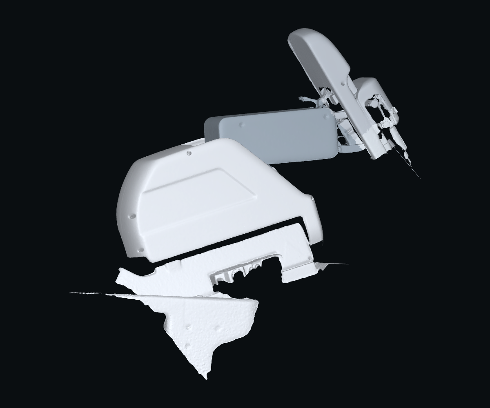
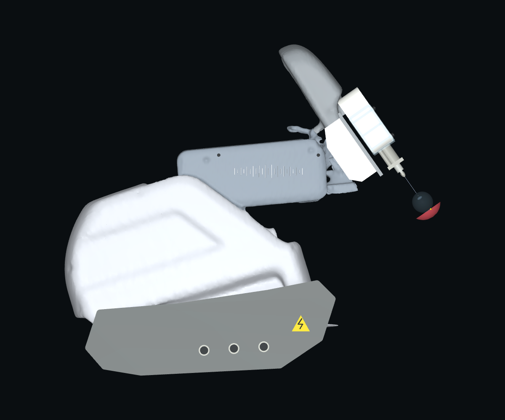
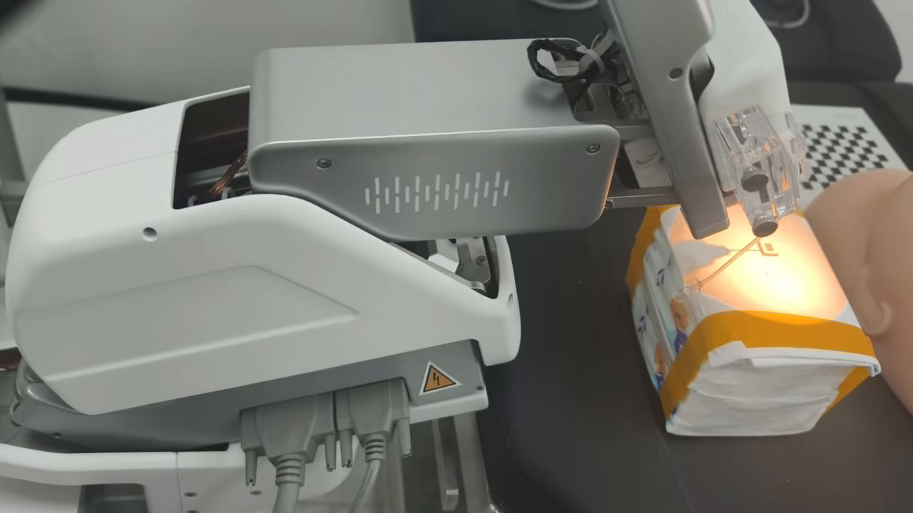
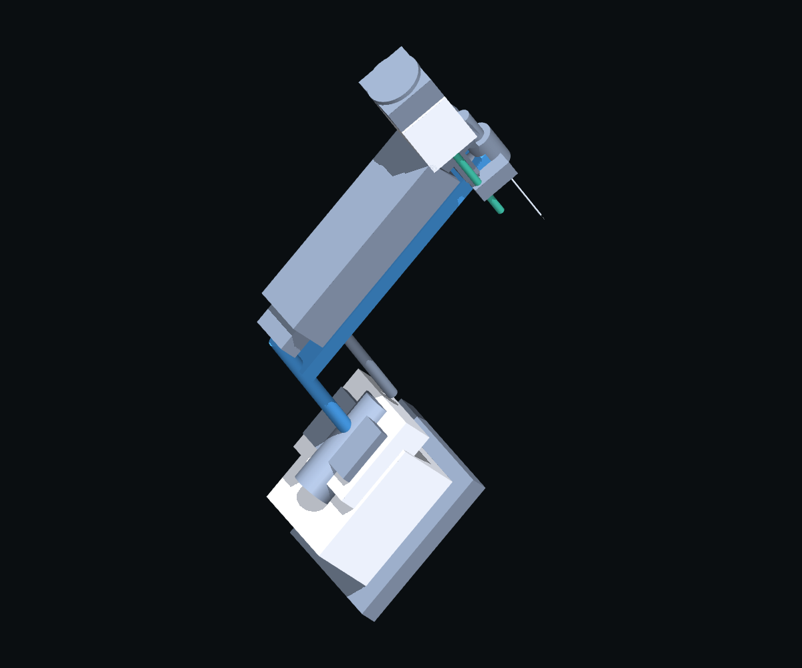

# source

- Source: `source.pptx`
- Total slides: 2

## Slide 1

从第一版到现在：整机外形与装配的累计优化

对比 GitHub main 的首个扫描版与当前集成版；最早原理模型另作区分，不只展示末次补洞

实物结构参考

首个扫描版 · main

当前集成版

仓库实拍视频帧 · 0.5 s

50b18b6 · 2026-10-29

084eac8 · 2026-11-02

与用户整机照片作定性结构核对

扫描外形已导入；前端、底座仍有缺面

闭合平滑外壳＋照片重建前端

01 外壳与部件归属

02 前端与针具统一

03 装配姿态与入口对齐

闭合、去毛边；白壳与银罩独立
修复显隐分组，前端组件不再被隐藏

白壳、透明夹、导杆、套管与针座重建
22＋4 mm 针具；统一 38 mm 装配基准

约 55° 侧姿、俯视轴线对齐
同步 RCM / 眼球 / 相机；补齐 B 承托体

更贴近实物结构，不等于实测 CAD：底座接口、线缆与机构间隙仍有简化；不同版本独立取景，非同尺度误差比较。

来源：Git 50b18b6 / 084eac8；TEST_LOG.md L42、70–71、139–146；仓库实拍帧不是聊天中新发照片原图。

01 / 02

### Speaker Notes

这一版汇报已经从最后一次补洞，改为梳理整个仓库从第一版到当前版的累计优化。版本基线必须先说清楚：仓库最早提交 df688d4 是十月二十二日的运动学原理示意模型；GitHub 主分支 main 当前仍指向十月二十九日的 50b18b6，这是首个导入仓库的扫描版；右侧当前模型来自工作分支 codex/v9-integration-20261030 的 084eac8，日期为十一月二日。不能把十一月二日的两次局部修改当作整个建模演进。

三张图都是真实来源。左侧是仓库 silver_reference_motion.mp4 的零点五秒实拍帧，明确不是聊天中新发整机照片的原图；用户照片用于定性核对白色主壳和箭头压筋、长银罩与条纹、抬升前端银帽、透明夹、针座和底座接口等可见结构。中间是直接加载 main 历史 scene.xml 的实际渲染，原始四份扫描网格的 Git 哈希与当前保留源资产一致，能够看到前端和底座的欠采样、缺面及碎片。右侧从当前 RCMSceneV9 实际模型渲染，显示闭合平滑外壳、重建前端与底座外观。模型采用各自独立取景，不能用这几张图进行同尺度尺寸或几何误差测量。

按照 TEST_LOG.md，首个扫描版入库时已经修复过白壳五百三十七个保护面以及银罩一千七百九十七个面的整体归属，所以不能把这些已经存在于 main 的修复算成 main 之后才发生的新增成果。后续的累计优化包括闭合显示网格、去毛边、部件关节挂载和显示组隔离；照片前端曾有六十三个显示件被窗口关闭环境分组时一并隐藏，这一显示问题后来通过区分机器人外观和环境组修复。

前端重建包括白壳、透明夹、导杆、带真实开孔的支架、金属套管和居中的双段针。物理针统一为二十二毫米近端和四毫米细段；白壳、导杆间距及套管等外观尺寸来自照片估计。十月三十一日为纠正六十毫米示意针连接基准和二十二毫米物理针不一致造成的装配偏低，沿现有轴重定了三十八毫米基准，RCM、眼球和相机同步更新，并移除了旧扫描前板和重复夹的遮挡。这项调整早已完成，本次制作PPT没有再次应用。侧视约五十五度和俯视轴线对齐也属于照片装配约束，不是硬件轴系标定。十一月二日补齐随B运动的承托体只是最后一项局部完善。

因此几何优化的结论是，模型表达和部件装配比早期扫描版更完整、更接近实物结构，但还不能称为实测 CAD 复刻。底座接口、线缆、局部表面和真实机构间隙仍然简化；不能因为照片里某处发黑，就把所有机构开口一律填实。

## Slide 2

从示意模型到可运行 v9：坐标、观测与执行同步升级

按 TEST_LOG.md 分期核验：不能把历史完整试采，当作最新几何的完整导航复验

更早的仓库起点

坐标 / 接口：解决扫描模型与研究配置不一致

扫描端 60 mm 硬编码 → 22 mm 配置近端针；细段 4 mm

修复入口求交，补齐 4 个位置传感器；重定基准时同步 RCM、眼球与相机。

观测链：对象 ID / 特征重渲染 → 严格 RGB-D

当前 RGB 提取掩码＋同一可见场景深度；正式入口默认 strict_rgbd。

不依赖仿真 ID 或隐藏几何控制；仍使用人工标记与理想深度，真实 OCT 未接入。

执行链：qpos 运动学回放 → MotorBackend 协议与反馈

50 ms 控制周期、2 ms 子步；实际编码器反馈回写，无直写目标回退。

df688d4 · 10/22 · 原理示意模型

正式入口显式开启电机；裸 Reference() 仍需手动开启。动力学尚未硬件辨识。

已有旧场景视觉研究，尚非实物外形

历史完整试采 · 10/31（本页引用已存报告，非本次重跑）

682 帧

5.87 μm

34.05 s

3 帧停稳

实际速度 / 加速度仍超限

独立终点误差与仿真时间；最新 11/2 几何只做局部回归：RGB-D 10/10、电机 7/7、45 组行程。

提升的是模型完整性与观测 / 执行一致性，不宣称精度单调提升。

限制：照片估计、碰撞关闭、动力学未辨识；最新几何未重跑完整导航，实机精度未验证。

来源：TEST_LOG.md L75–82、128–146；reports/20261031/strict_rgbd；11/2 局部验证。详细版本审计见随附文档。

02 / 02

### Speaker Notes

外形变化之外，TEST_LOG.md 还记录了坐标、观测和执行链路的逐步迁移。左侧是直接从 df688d4 历史 scene.xml 实际渲染的最早原理模型，它由方盒、圆柱和示意连杆组成。这个版本已经有旧研究场景的眼球、视觉伺服和导航研究，所以不能声称早期完全没有感知；真正的升级是把这些研究接口逐步迁移和核验到扫描v9，而不是只让窗口看起来像v9。

第一条是统一坐标和参数源。早期扫描模型的 needle_base 硬编码为六十毫米，与研究配置的二十二毫米近端针不一致，后来统一从配置生成。还修复了眼球入口求交曾经误报距离RCM二十四毫米的问题，补齐四个 framepos 位置传感器，并明确机器人毫米坐标和各版本世界坐标之间的边界。三十八毫米基准修订时，RCM、眼球和相机必须一起更新，旧版本世界坐标不能不经转换直接拿来使用。

第二条是严格观测链。迁移过程中曾出现窗口显示v9、控制器仍运行legacy的阶段，也出现过把分割图对象类型通道理解错误的诊断。当前正式入口使用v9和strict_rgbd，通过当前RGB检测特征掩码，深度来自同一个正常可见场景；控制测量不使用仿真对象ID或隐藏几何重渲染。历史上放宽端面拟合条件得到的虚假收敛，因独立三维误差达到约三百四十二微米而被拒绝并撤销，这说明不能把视觉残差通过等同于独立位置验收。当前仍依赖人工颜色标记和理想注册深度，真实OCT未接入。

第三条是电机执行链。保留的纯运动学研究路径会直接回放qpos；正式视觉伺服入口和采集器则显式开启MotorBackend，下发协议目标，以两毫秒子步积分，五十毫秒控制一次，再用实际编码器反馈回写场景，没有失败后直接写目标姿态的回退。裸Reference对象仍须自行开启电机，不能由一个全局配置字段缺失就推断正式入口没有电机执行。这个一阶电机模型仍未硬件动力学辨识。

底部数字来自十月三十一日已经归档的严格RGB-D加电机单目标完整试采：六百八十二帧、三十四点零五秒仿真时间，独立终点误差约五点八七微米，连续三帧编码器停稳。其到达和数据重放通过，但实际速度、加速度仍超过名义门限，不能把到达通过说成所有运动约束都通过。十一月二日最新几何只重新做了严格RGB-D十项、电机七项、四十五组B/C行程等局部回归，没有再次运行整个导航，所以这次试采不能冒称当前全部几何的完整闭环结果。

累计优化提升的是模型完整性、参数和坐标来源统一，以及观测与执行链的一致性，不代表误差随版本单调下降。模型仍有照片估计、碰撞关闭、惯量和电机动态未标定等限制；真实OCT、实机制动、组织接触和临床精度都没有验证。所有版本结论和不通过项目应结合随附的TEST_LOG原文选摘与版本审计阅读。
