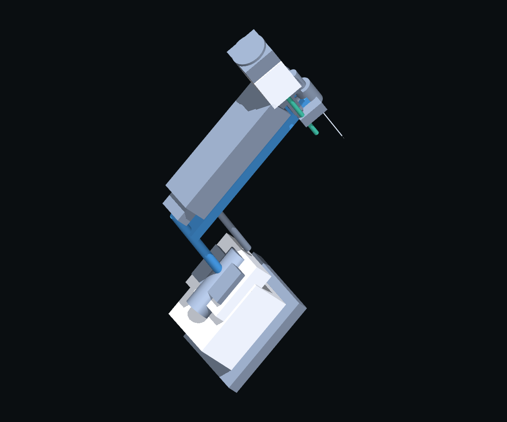
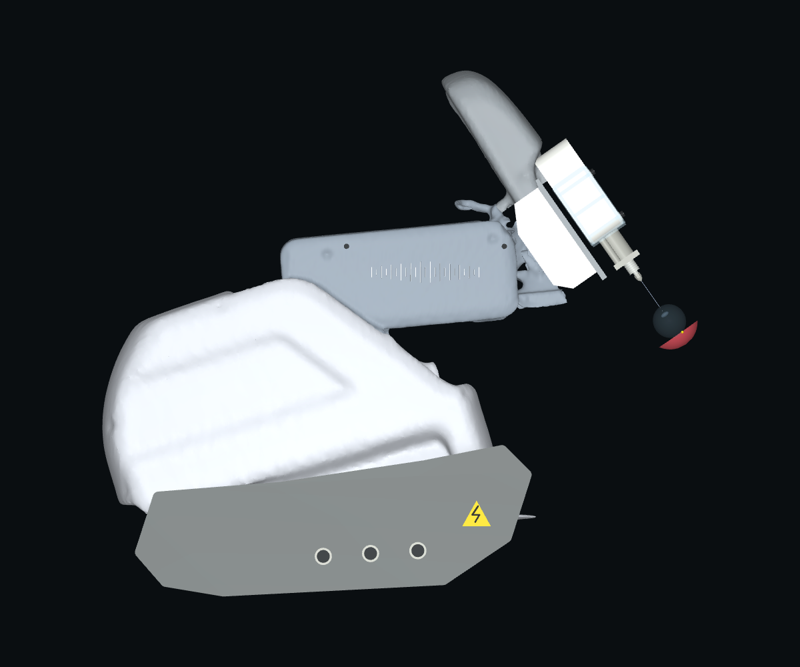
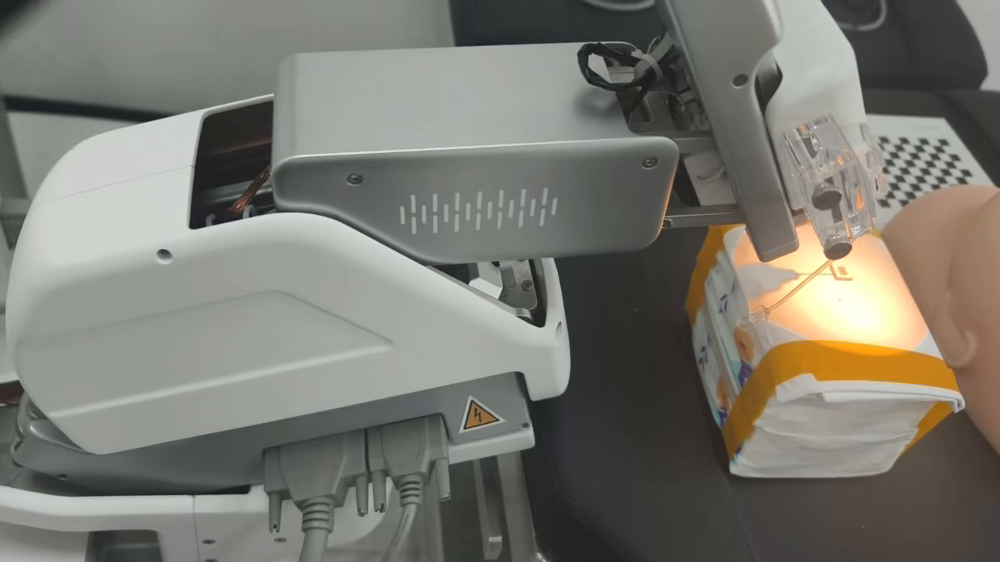
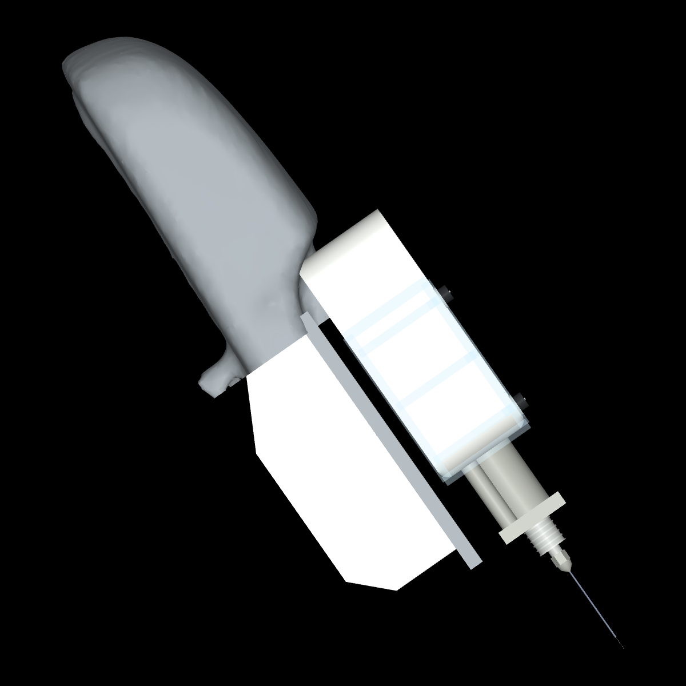

# source

- Source: `source.pptx`
- Total slides: 2

## Slide 1

从最早模型到当前：整机外形与装配的累计优化

实物结构参考

最早仓库起点

当前集成模型

真实机械臂（仓库视频帧）

df688d4 · 10/22 · 原理示意

084eac8 · 11/02 · 扫描重建

外形重建

装配统一

运动归属

几何基元 → 扫描与闭合外壳
补全白壳、底座与前端组件

22＋4 mm 双段针具
38 mm 基准与 RCM / 相机对齐

白壳、银罩、针座分体运动
保留 B/C 接口与伸缩间隙

外形与尺寸依据照片估计，尚非实测 CAD；独立取景，非同尺度精度比较。

### Speaker Notes

这一页中间按用户要求改为真正的最早仓库起点：十月二十二日提交df688d4的原理示意模型，直接从该历史提交的scene.xml实际渲染。它由几何基元和示意连杆组成，已经有旧研究场景视觉研究，但不是扫描实物外观。左侧是仓库silver_reference_motion.mp4第零点五秒实拍帧；右侧是十一月二日084eac8当前集成模型。三个画面分别取景，不能作同尺度量化误差比较。

从最早版本到现在的累计优化包括三方面。外形上，从几何基元演进到扫描重建，并逐步进行显示网格闭合、去毛边、白色主壳、底座与前端组件重建。装配上，近端二十二毫米、细段四毫米的物理针具统一从配置生成；扫描迁移阶段曾有六十毫米示意连接基准与二十二毫米物理近端不一致的问题，十月三十一日沿现有轴重定三十八毫米基准，同步RCM、眼球和相机，该调整已经完成，没有再次应用。运动归属上，白壳、银罩和针座分体挂载，保持B/C接口和伸缩间隙，最新承托体随B补全只是整个优化的最后一项。

历史中间阶段还包括十月二十九日50b18b6首个扫描版，GitHub main目前仍指向该提交；它不是仓库最早起点，因此本页不再把它放在中间。该扫描版入库时已有五百三十七个白壳保护面与一千七百九十七个银罩面的归属修复，后续才继续闭合平滑显示壳、修复显隐分组、重建前端。前端曾有六十三个显示件因为与环境共用显示组而被隐藏，后来统一归到机器人外观组，环境和示意连杆单独隐藏。

来源为完整TEST_LOG.md，重点见第42、70至82、139至146行，以及Git历史渲染来源记录。实物图不是聊天中新发照片的原图；那张照片只用于白壳、长罩、前银帽、夹具、套管和底座等可见结构的定性核对。尺寸和姿态仍是照片约束估计，底座接口、线缆与真实机构开口也有简化，不是实测CAD或硬件标定。详细出处、独立取景说明及中间版本记录都移到本备注和随附版本审计，不在页面放细小文字。

## Slide 2

模型之外：坐标、感知与电机闭环同步升级

当前前端模型

01 坐标与针具统一

统一近端针 22 mm；细段 4 mm
RCM、眼球、相机同步对齐

02 严格 RGB-D 观测

当前 RGB 掩码＋同场景深度
仍依赖人工标记，真实 OCT 尚未接入

03 电机执行闭环

MotorBackend：协议目标 → 编码器反馈
50 ms 控制 / 2 ms 积分；无直写目标回退

针具 / 装配 / 接口统一

历史完整试采 · 10/31

682 帧

5.87 μm

3 帧停稳

速度 / 加速度仍超限

最新几何：RGB-D 10/10、电机 7/7；尚未重跑完整导航。

照片估计、碰撞关闭、动力学未标定；不代表实机精度。

### Speaker Notes

第二页用当前前端实际渲染图，说明外形之外的坐标、感知和电机执行升级。近端针统一为二十二毫米，细段为四毫米；这里说的是参数源统一，不是声称最早原理模型的物理针从六十毫米缩短。六十毫米硬编码发生在扫描模型迁移阶段。还修复过入口求交误报距离RCM二十四毫米的问题，并补齐四个framepos位置传感器，使RCM、眼球和相机在统一坐标下对齐。

观测链当前从RGB提取掩码，使用同一正常可见场景的注册深度，正式入口默认strict_rgbd。控制测量不依赖仿真对象ID或隐藏几何重渲染；但仍依赖人工颜色标记和理想仿真深度，真实OCT尚未接入。迁移过程中曾经出现窗口显示v9而控制器仍运行legacy的阶段，所以不能把外观切换等同于控制系统已迁移。

执行链由保留的纯运动学qpos回放路径，发展到正式视觉伺服入口和采集器显式开启MotorBackend，发送协议目标，以两毫秒子步积分，五十毫秒控制一次，再将实际编码器反馈回写场景。没有失败后直接写目标姿态的回退。裸Reference对象仍须自行开启电机；一阶电机动态、质量惯量和真实动力学尚未硬件辨识。

底部是十月三十一日已经归档的历史完整试采：六百八十二帧，独立终点误差约五点八七微米，连续三帧编码器停稳，仿真时间三十四点零五秒。但是实际速度和加速度仍超过名义门限，不能把到达通过说成全部运动质量通过。十一月二日最新几何仅重跑严格RGB-D十项、电机七项以及四十五组B/C行程等局部回归，没有重新运行整个导航。因此历史试采不等于当前最新几何的完整闭环复验。

依据TEST_LOG第75至82、128至146行及reports/20261031/strict_rgbd的pilot_result.json和dataset_verification.json。照片估计、碰撞关闭、动力学未标定、真实OCT未接入以及实机精度未验证等边界保留；不把不同时期的微米级误差当作精度单调提升的证据。所有较细的测试说明和来源已经移到讲解备注，页面只保留大字号核心结论。
