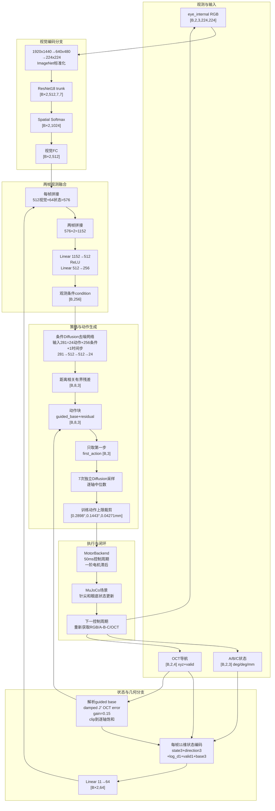
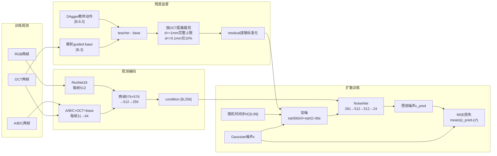

# 当前 v9 策略从输入到输出架构

本文按完整运行时链路描述当前 v9 guided-OCT Diffusion Policy：从
`eye_internal` 相机和机器人状态开始，经过视觉编码、状态编码、两帧融合、
guided base、Diffusion 残差采样、动作聚合和 MotorBackend，最终形成下一
控制周期状态。文档同时说明训练目标、推理差异和当前实现边界。

## 1. 状态与范围

当前模型分为两个层次：

```text
最新训练候选：
v9 terminal-DAgger guided-OCT Diffusion Policy

当前经过闭环验证的工程 baseline：
v7 guided-OCT Diffusion Policy
```

v9 使用 v7 初始化并增加 200 集 terminal DAgger 数据。网络结构与 v7 相同，
区别在训练数据。v9 已完成与 v7/v8 相同的固定 20 目标闭环评估，结果为
`19/20`；最差最终误差从 v7 的 `47.926 µm` 改善到 `23.146 µm`，但没有
提升成功数量，平均/中位最终误差仍不足以替换 v7。

本文描述主策略。Restricted Stage 2/3 的 `533` 维输入和双 MLP 分支属于
另一条研究路线，不是当前 v9。

## 2. 单位、频率与时间窗口

任务状态和动作统一使用：

```text
A: degree
B: degree
C: millimetre
```

控制周期：

```text
dt = 0.05 s
frequency = 20 Hz
```

在时刻 `t`，策略读取两个连续观测：

```text
previous = t-1
current  = t
```

观测历史长度：

```text
n_obs_steps = 2
```

策略同时预测从时刻 `t` 开始的 8 个增量动作：

```text
t, t+1, ..., t+7
```

动作时间跨度：

```text
8 × 0.05 s = 0.4 s
```

闭环推理只执行动作块第一步，随后重新感知和预测，属于 receding-horizon
控制：

```text
预测8步 → 只执行第1步 → 下一控制周期重新预测
```

### 2.1 动作语义、历史与缺帧

数据契约 v2 明确区分两种动作：

```text
action          = 训练监督标签
executed_action = 实际接受并下发的增量命令
```

DAgger 数据的 `action` 来自 `teacher_action_deg_deg_mm`；速度状态仍由实际
相邻状态计算，`previous_action` 输入则必须来自 `executed_action`。推理端
记录的上一动作同样是已接受命令，因此训练与推理语义一致。

同时保存过滤前的 `source_frame_index` 和 `timestamp_s`。观测历史、速度计算
和未来动作块只允许使用原始帧号逐帧连续的样本；过滤无效专家帧形成的缺口会
切断窗口，不能把过滤后的相邻数组行当作固定 50 ms 间隔。

## 3. 端到端总览

```text
eye_internal RGB
      │
      ├── 图像策略分支 ────────────────→ ResNet18 → 512维/帧
      │
      └── Strict RGB-D感知分支
             ├── A/B/C状态 [3]
             └── OCT target-minus-tip [4]
                        │
                        └── 几何雅可比 → guided base [3]

RGB特征 + A/B/C/OCT/guided-base状态特征
                    │
                    ▼
             两帧联合特征 [1152]
                    │
                    ▼
             条件向量 [256]
                    │
                    ▼
          Diffusion预测有界动作残差
                    │
                    ▼
          guided base + bounded residual
                    │
                    ▼
              8×3动作块，只执行第1步
                    │
                    ▼
             7次采样逐轴中位数
                    │
                    ▼
         动作限幅 → MotorBackend执行
                    │
                    ▼
              下一控制周期
```

### 3.1 总体框架图

下图同时标出视觉编码、状态编码、解析几何 guided base、Diffusion 残差、
动作块聚合和 MotorBackend 闭环反馈。箭头方向表示一次控制周期的信息流；
从场景回到 RGB、A/B/C 和 OCT 的反馈边表示下一控制周期重新观测。



图中的两条学习/解析分支必须区分：

```text
guided base:
由OCT和状态通过解析雅可比计算，不在策略网络中学习

Diffusion residual:
由RGB、A/B/C、OCT和guided base条件驱动，是当前可学习策略
```

## 4. 相机输入

当前相机：

```text
name = eye_internal
width = 1920 px
height = 1440 px
vertical_fov = 45 deg
near = 0.1 mm
far = 60 mm
channels = RGB
dtype = uint8
```

单帧原始图像：

```text
shape = [1440, 1920, 3]
channel_order = RGB
```

相机图像进入两条相互独立的路径：

1. 图像策略路径：图像缩放后输入 ResNet18。
2. 严格感知路径：图像和同一可见场景深度用于目标、针尖和 OCT 相对向量测量。

感知路径生成的目标掩码、针尖掩码和几何点不会直接输入策略网络。策略视觉
输入是普通 RGB 图，不包含检测框、分割掩码、引导线或真值目标坐标。

## 5. 严格 RGB-D 感知与 OCT 导航

严格 RGB-D 传感器使用固定相机位姿和同一可见场景，不使用仿真对象 ID 控制，
也不使用隐藏几何重渲染。

OCT 接口输出：

```text
oct_raw_t = [dx, dy, dz, valid]
```

其中：

```text
[dx, dy, dz]
= target_position - tip_position
```

单位：

```text
dx, dy, dz: mm
valid: 0.0或1.0
```

坐标系：

```text
camera_optical
```

该输入是用于导航的仿真配准深度向量，不是真实 A-scan/B-scan，也不代表已经
验证真实 OCT 精度。

目标真值只用于闭环评估和最终误差统计，不进入策略输入，也不用于选择动作。

## 6. A/B/C 状态

两帧 A/B/C：

```text
state_t = [A_t, B_t, C_t]
shape = [B, 2, 3]
```

状态标准化：

```text
state_normalized =
    (state - state_mean) / state_std
```

v9 checkpoint 记录的训练统计量：

```text
state_mean =
[-0.0239998, -0.0456761, 11.6506510]

state_std =
[6.5896020, 5.8576303, 6.4402876]
```

两根旋转轴使用角度单位，C 轴使用毫米单位，因此统计和动作限幅都必须保留
原始物理单位。

## 7. 图像预处理

训练和推理遵循相同尺度链路。

原始：

```text
1920×1440
```

第一次缩放：

```text
1920×1440 → 640×480
interpolation = bilinear
```

第二次缩放：

```text
640×480 → 224×224
interpolation = bilinear
```

最终策略图像：

```text
[224, 224, 3] uint8 RGB
```

张量化与标准化：

```python
ToTensor()
Normalize(
    mean=[0.485, 0.456, 0.406],
    std=[0.229, 0.224, 0.225],
)
```

单样本图像输入：

```text
[B, 2, 3, 224, 224]
```

当前主策略没有高斯模糊、中心涂黑、目标框叠加或 mask 拼接。Restricted
Stage 1–4 中使用的 blur/occlusion 研究变体不属于当前 v9 输入。

## 8. ResNet18 视觉编码

每帧图像进入 ResNet18：

```text
[B×2, 3, 224, 224]
```

ResNet18 去掉最后的 average pooling 和 ImageNet 分类器，保留最后卷积特征：

```text
[B×2, 512, 7, 7]
```

维度的含义：

```text
512 = 通道数
7×7 = 49个空间位置
```

当前位置没有直接使用 global average pooling，而是使用 Spatial Softmax：

```text
512×7×7
→ 每个通道在49个位置上做softmax
→ 每个通道得到期望x、期望y
→ 512×2 = 1024
→ Linear(1024→512)
→ 每帧视觉特征 [512]
```

两帧输出：

```text
[B, 2, 512]
```

v9 训练时视觉编码器冻结。训练集图像特征预计算为：

```text
[N, 512] float16
```

闭环推理时从实时 RGB 在线执行 ResNet18，不使用离线图像缓存。

## 9. A/B/C、OCT 与 guided base 状态编码

OCT 原始 4 维向量先被转换为稳定的几何表示。

设：

```text
xyz = oct_raw[..., :3]
d = ||xyz||
```

单位方向：

```text
direction = xyz / d
```

对数距离：

```text
log_distance = log(max(d, 1e-4))
```

有效位：

```text
valid = oct_raw[..., 3:4]
```

每帧状态编码输入：

```text
A/B/C normalized          3
OCT unit direction        3
log(distance)             1
valid                     1
guided base normalized    3
                          ─
总计                     11
```

网络层：

```text
Linear(11→64)
```

当前该层后没有额外激活：

```text
[B, 2, 11] → [B, 2, 64]
```

guided base 只有当前帧一个 `[B,3]` 向量；在形成两帧输入时，会复制到两个
历史帧位置。

## 10. guided base 的计算

guided base 是解析几何基础动作，不是基础 MLP。

输入：

```text
当前A/B/C状态
OCT camera-frame target-minus-tip向量
camera-to-world旋转
```

相机向量转换到 world frame：

```text
e_world = R_camera_to_world @ (e_camera / [1, -1, -1])
```

计算当前状态下的数值任务雅可比：

```text
J = d(tip_world_mm) / d(A_rad, B_rad, C_m)
```

使用阻尼伪逆：

```text
delta_task = damped_pseudoinverse(J) @ e_world
```

转换到 A/B/C 动作单位并乘增益：

```text
guided_base =
    gain × clip(delta_task, -saturation, saturation)
```

当前 checkpoint 配置：

```text
gain = 0.15
relative_damping = 0.001
saturation =
[0.28979999°, 0.14434358°, 0.04271207 mm]
```

OCT 无效或距离接近零时：

```text
guided_base = [0, 0, 0]
```

该路径使网络不需要从零学习接近方向，视觉 Diffusion 只负责学习基础几何
动作之外的修正。

## 11. 两帧联合特征

每帧视觉特征与状态特征拼接：

```text
[512, 64] → 576
```

两帧：

```text
[576(t-1), 576(t)] → 1152
```

融合网络：

```text
1152 → Linear → 512
     → ReLU
     → Linear → 256
```

输出：

```text
condition c = [B, 256]
```

三个容易混淆的“联合特征”层级如下：

```text
单帧联合特征: 512 + 64 = 576
两帧联合特征: 576×2 = 1152
最终条件向量: 1152 → 256
```

当前 v9 中，`condition [256]` 后面直接进入 Diffusion 噪声预测网络。

## 12. 训练动作和残差标签

数据中的动作是增量动作：

```text
action_t = [dA_t, dB_t, dC_t]
```

当前 v9 训练集使用 DAgger 教师标签：

```text
action_source = teacher
action = teacher_action_deg_deg_mm
```

教师标签只用于监督，不用于构造上一动作历史。历史动作必须读取同一行记录的
`executed_action_deg_deg_mm`，包括实际执行的 policy、teacher 或 hold 命令。

教师动作与 guided base 相减：

```text
residual_target =
    teacher_action - guided_base
```

随后进行距离相关裁剪：

```text
residual_target =
    clip(residual_target, -limit, +limit)
```

距离缩放：

```text
alpha = clamp(distance / 1.0 mm, 0.1, 1.0)
limit = alpha × far_residual_limit
```

远端完整上限：

```text
far_residual_limit =
[0.28979999°, 0.14434358°, 0.04271207 mm]
```

因此：

```text
distance >= 1 mm:
使用完整残差上限

0.1 mm < distance < 1 mm:
残差上限随距离减小

distance <= 0.1 mm:
最多使用远端上限的10%

OCT invalid:
residual limit = 0
```

训练时对 8 个未来动作步使用同一个当前 guided base：

```text
residual_target[k] =
    action[t+k] - guided_base[t]
```

然后对残差进行逐轴标准化：

```text
residual_normalized =
    (residual - residual_mean) / residual_std
```

v9 checkpoint 记录的残差统计量：

```text
residual_mean =
[0.00039857, -0.00019118, 0.02902644]

residual_std =
[0.04562975, 0.03001807, 0.01357494]
```

## 13. Diffusion 训练结构

动作预测范围：

```text
n_action_steps = 8
action_dim = 3
flattened_action_dim = 24
```

扩散调度：

```text
schedule = cosine
num_diffusion_iters = 100
```

训练时随机采样扩散时间步：

```text
t ∈ [0, 99]
```

采样标准 Gaussian 噪声：

```text
epsilon ~ N(0, I)
```

对标准化残差加噪：

```text
noisy_residual =
    sqrt(alpha_bar_t) × residual_normalized
    + sqrt(1 - alpha_bar_t) × epsilon
```

噪声预测网络输入：

```text
24维 noisy residual
+ 256维 observation condition
+ 1维 normalized timestep
= 281维
```

网络结构：

```text
281 → Linear → 512
    → ReLU
    → Linear → 512
    → ReLU
    → Linear → 24
```

网络输出：

```text
epsilon_pred
```

损失：

```text
L = mean((epsilon_pred - epsilon)^2)
```

当前 A/B/C 三个动作轴损失权重相同：

```text
loss_weights = [1.0, 1.0, 1.0]
```

未来 8 个动作步也等权计算。

### 13.1 训练目标框架图



该图对应训练阶段。闭环推理不提供教师动作，也不直接回归清洗后的残差；
而是从 Gaussian 噪声开始，用同一个 `NoiseNet` 执行 100 步 DDIM。

## 14. Diffusion 推理

闭环推理从纯 Gaussian 动作噪声开始：

```text
r_T ~ N(0, I)
shape = [1, 24]
```

使用 100 步 DDIM 反向去噪。每个时间步执行：

1. 拼接当前动作、`condition`、归一化时间步。
2. 网络预测噪声。
3. 计算预测的干净残差 `x0`。
4. 对 `x0` 做训练范围裁剪。
5. 使用 DDIM 公式更新下一时间步。

`x0` 裁剪：

```text
pred_x0_clip = 4.0
```

最终得到：

```text
[1, 8, 3] normalized residual
```

反标准化：

```text
residual =
    normalized_residual × residual_std
    + residual_mean
```

按当前距离重新裁剪：

```text
residual =
    clip(residual, -residual_limit, +residual_limit)
```

加上 guided base：

```text
action_chunk =
    guided_base + residual
```

输出：

```text
[1, 8, 3]动作块
```

## 15. 七样本中位数

每个控制周期独立运行 7 次 Diffusion 采样：

```text
sample_1 → action_chunk_1 → first_action_1
sample_2 → action_chunk_2 → first_action_2
...
sample_7 → action_chunk_7 → first_action_7
```

聚合只发生在动作块第一步：

```text
final_action =
median(first_action_1, ..., first_action_7)
```

逐轴计算：

```text
dA_final = median(dA_1, ..., dA_7)
dB_final = median(dB_1, ..., dB_7)
dC_final = median(dC_1, ..., dC_7)
```

只取中位数可以降低单个极端 Diffusion 样本对闭环的影响。

默认闭环每次执行第 1 步，但评测器已支持在一次预测后连续执行 1/2/4 步，
并通过 action queue 复用同一动作块。7 个样本默认在单次 CUDA batch 中并行
生成，显存不足时回退为顺序采样。单次 7-sample parallel smoke 约 `0.229 s`。
完整 20 目标验证中执行 2 步没有优于执行 1 步，执行 4 步的 7 目标筛选更差，
因此默认仍执行第 1 步。

## 16. 动作限幅

七样本中位数后执行训练数据动作范围裁剪：

```text
action_abs_limit =
[0.28979999°, 0.14434358°, 0.04271207 mm]
```

然后计算下一状态：

```text
new_state =
    current_state + final_action
```

如果当前场景状态约束拒绝该动作，评估器按以下比例依次回退：

```text
1.0 → 0.5 → 0.25 → 0.125 → 0.0625 → 0
```

全部失败则停止 episode。连续安全限位达到 20 步时提前终止。

## 17. MotorBackend

动作不是直接瞬时写到 qpos，而是经过一阶电机响应：

```text
command
→ MotorBackend
→ first-order lag
→ actual position and velocity
→ next observation
```

当前配置：

```text
control_period_s = 0.05
motor_tau_s = 0.04
speed_limits =
[10 deg/s, 10 deg/s, 2 mm/s]
```

下一帧 A/B/C 状态由实际执行后的任务状态形成，而不是直接复制网络预测状态。

## 18. 闭环更新

执行动作后：

```text
仿真推进0.05 s
    → 获取新的RGB
    → 获取新的A/B/C状态
    → 获取新的OCT target-minus-tip
    → 获取电机实际速度
```

两帧缓冲更新：

```text
old = [t-1, t]
new = [t, t+1]
```

随后重新执行：

```text
图像预处理
→ ResNet18
→ 状态编码
→ two-frame fusion
→ guided base
→ 7×Diffusion sampling
→ median
→ action limit
→ MotorBackend
```

## 19. 闭环成功判据

误差定义：

```text
error =
||tip_world - target_world||
```

成功条件：

```text
error < 20 μm
```

且 `MotorExecution.settled()` 连续 3 帧为真。该条件要求实际编码器已经到达
量化命令目标并且保持静止：

```text
backend.robot == backend.target
abs(actual_velocity) < 1e-12 rad/rad/m/s
```

低速阈值仍作为诊断字段记录：

```text
abs(vA) <= 0.05 deg/s
abs(vB) <= 0.05 deg/s
abs(vC) <= 0.01 mm/s
```

但低速本身不再单独构成成功，避免电机仍在追赶命令时提前结束评估。

评估限制：

```text
max_steps = 1600
early_stop_error = 30 mm
max_consecutive_safety_limited = 20
```

目标真值只用于成功判断和误差统计，不用于动作选择。

## 20. 张量维度汇总

| 模块 | 输入 | 输出 |
|---|---:|---:|
| RGB | `[B,2,3,224,224]` | - |
| ResNet18 trunk | `[B×2,3,224,224]` | `[B×2,512,7,7]` |
| Spatial Softmax | `[B×2,512,7,7]` | `[B×2,1024]` |
| 视觉 FC | 1024 | 512 |
| A/B/C + OCT + base | 11 | - |
| 状态 Linear | 11 | 64 |
| 单帧联合 | 512+64 | 576 |
| 两帧联合 | 576×2 | 1152 |
| 条件融合 | 1152 | 512→256 |
| Diffusion 输入 | 24+256+1 | 281 |
| Diffusion MLP | 281 | 512→512→24 |
| 动作块 | 24 | 8×3 |

## 21. v9 训练配置与数据

当前 v9 训练数据：

```text
train episodes = 690
train frames = 163,097
valid training windows = 157,580

val episodes = 100
val frames = 29,000
valid validation windows = 28,200
```

训练配置：

```text
initialization = v7 best_model.pth
vision encoder = frozen
vision feature cache = enabled
guided OCT = enabled
n_obs_steps = 2
n_action_steps = 8
diffusion schedule = cosine
diffusion iterations = 100
epochs = 4
batch_size = 48
learning_rate = 5e-5
optimizer = AdamW
weight_decay = 1e-4
scheduler = CosineAnnealingLR
AMP = fp16
```

最佳 checkpoint 为 epoch 1：

```text
normalized action MAE = 0.231271
A MAE = 0.0116817 deg
B MAE = 0.0061930 deg
C MAE = 0.0031425 mm
```

checkpoint：

```text
outputs/diffusion_policy_v9_terminal_dagger_20261113/best_model.pth
```

离线 MAE 只表示动作拟合指标，不能替代闭环评估。

### 21.1 v9 闭环结果

评估协议与 v7/v8 相同：

```text
seeds = 20271105, 20271106, 20271107
target shards = 7/7/6
strict RGB-D + MotorBackend + OCT
7-sample median
max_steps = 1600
success threshold = 20 µm + 连续3帧停稳
early stop = 30 mm
```

结果：

```text
success = 19/20
uncontrolled > 30 mm = 0/20
safety-limited steps = 0
final-error mean/median/min/max =
11.159 / 10.865 / 7.437 / 23.146 µm
```

与 v7 逐目标配对时，v9 改善 `5/20`、恶化 `15/20`，
平均最终误差变化 `-0.091 µm`，中位变化 `+0.945 µm`。
因此 v9 的主要收益是失败尾部收窄，而不是整体成功率或中位精度提升。
固定 20 目标唯一失败集停在 `23.146 µm`，最后阶段 OCT invalid、
动作和速度均为零，没有失控或 safety-limited step。

### 21.2 H4 frozen final-test 结果

H4 使用完整 60 个冻结 final-test targets，结果仅为：

```text
20 µm success = 28/60 = 46.7%
10 µm success = 9/60 = 15.0%
final error median = 21.295 µm
final error P95 = 332.104 µm
final error max = 19156.335 µm
```

35/60 曾进入 20 µm，但其中只有 28 个完成三帧停稳；25/60 从未进入
20 µm。3 个 episode 因连续 safety-limit 早停。该结果说明固定开发目标上的
成功不能外推到 final-test，目标分布覆盖和终端稳定仍是主要问题。

这组历史结果产生于评估契约 v2 之前，其中“停稳”只能解释为连续三帧低于
速度阈值；它没有验证编码器已经到达量化目标，不能与新的
`MotorExecution.settled()` 成功数直接比较。

## 22. 当前输入不包含什么

当前 v9 不显式输入：

- 电机实际速度。
- 上一步执行动作。
- 目标世界坐标真值。
- 目标类别。
- 分割 mask。
- 深度图原始张量。
- 真实 OCT A-scan/B-scan。
- 力反馈或接触状态。

两帧 A/B/C 和图像历史提供有限运动信息，但网络没有独立速度输入。

## 23. 与 Restricted Stage 3 的区别

当前 v9：

```text
RGB两帧 + A/B/C + OCT + guided base
→ 两帧视觉/状态融合
→ Diffusion bounded residual
→ guided_base + residual
```

Restricted Stage 3：

```text
512视觉 + 3维A/B/C + 18维restricted vector
= 533维联合特征
→ Stage2基础MLP：533→512→512→3
+ Stage3残差MLP：533→256→256→3→tanh×limit
```

当前 v9 没有 `Stage 2 base MLP` 和 `Stage 3 residual MLP` 两个并行分支。
当前 guided base 是解析几何计算，不是神经网络。

Restricted Stage 3 未作为主策略采用。它在 development targets 上达到
`40/40`，但冻结 final-test 只有 `20/180` 达到 20 μm；七样本 Diffusion
control 为 `18/60`。此外，51 个 final-test episode 曾进入 20 μm，但无法
连续三帧停稳，fine OCT 可用率仍为 `99.52%`。失败主因是目标泛化与终端
稳定，而不是 OCT 可用性或推理速度。

## 24. 当前实现限制

- 只有两帧观测历史。
- 没有 RNN、GRU、Transformer 或显式速度状态。
- 预测 8 步但只执行 1 步。
- 7 次 Diffusion 推理增加闭环延迟。
- ResNet18 输入为直接拉伸的 224×224，不保持原始 4:3 比例。
- OCT 是仿真可见场景深度得到的导航接口，不是真实 OCT。
- 当前验证是 MuJoCo 仿真，不证明真实相机、真实组织、接触或临床安全。
- v9 已完成固定 20 目标闭环评估，但成功数量与 v7 相同且中位误差更差，
  不能替代 v7 的已验证 baseline。
- v10 四帧历史、速度和上一步动作改善离线 MAE，但闭环成功仍为 `19/20`，
  失败尾部比 v9 更差。
- action-chunk 执行 2 步没有精度收益，执行 4 步筛选结果更差。

## 25. 代码入口

- 模型结构与训练：
  [`lerobot_training/train_diffusion_policy.py`](../lerobot_training/train_diffusion_policy.py)
- 训练入口：
  [`lerobot_training/train_oct_policy.py`](../lerobot_training/train_oct_policy.py)
- guided base 生成：
  [`lerobot_training/prepare_guided_oct_base.py`](../lerobot_training/prepare_guided_oct_base.py)
- guided action 与雅可比：
  [`lerobot_training/train_oct_guided_regression.py`](../lerobot_training/train_oct_guided_regression.py)
- 闭环策略评估：
  [`lerobot_training/eval_policy.py`](../lerobot_training/eval_policy.py)
- 图像处理细节：
  [`IMAGE_PROCESSING_PIPELINE.md`](IMAGE_PROCESSING_PIPELINE.md)
- Restricted 输入与 Stage 3：
  [`RESTRICTED_INPUT_PIPELINE.md`](RESTRICTED_INPUT_PIPELINE.md)

