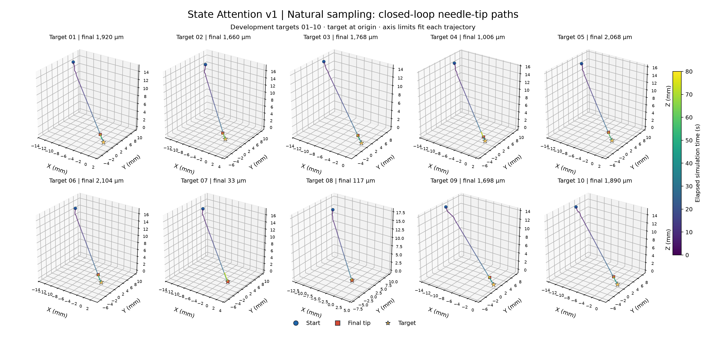
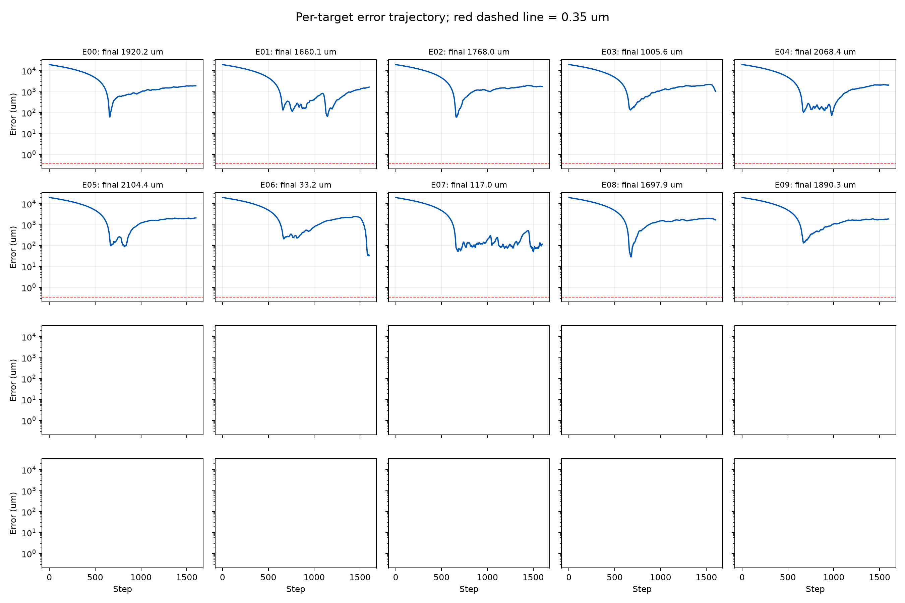
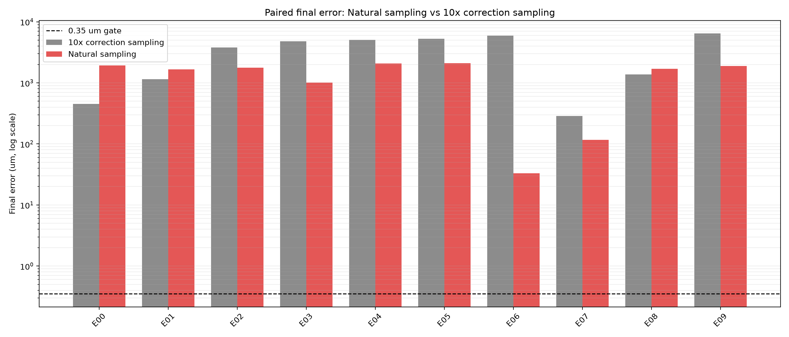

# State Attention v1: natural sampling on the Plan 2 merge

The model starts from frozen State Attention v1 and trains for four epochs on
1,039 episodes (839 original and 200 Plan 2). Each epoch shuffles all valid
training windows without weighting the new data. The best checkpoint is from
epoch 4, with validation loss `0.144349` on the existing 40-episode validation
set. Checkpoint SHA-256:
`70815e88cc41f6f92bb0bb043370c8b86cae23687705ce1b7090fa939393fe2f`.

The same ten development targets are paired by index, target ID and seed.
Each evaluation uses base seed 42, a 50 ms control period, up to 1,600 steps,
and a success gate of 0.35 µm plus three consecutive settled frames.

| Closed-loop metric | Frozen v1 | 10× sampling | Natural sampling |
|---|---:|---:|---:|
| Mean final error (µm) | **351.16** | 3,458.69 | 1,426.52 |
| Median final error (µm) | **258.93** | 4,308.96 | 1,732.92 |
| Mean of per-target minimum errors (µm) | 102.76 | 3,204.78 | **73.29** |
| Strict successes | 0/10 | 0/10 | 0/10 |

Natural sampling reduces mean final error by 58.8% versus 10× sampling, with
7 of 10 targets improving, but remains worse than frozen v1 at the end of
the run. Eight natural-sampling trajectories reach 100 µm at some point;
only one finishes within 100 µm and none finish settled.

## Needle-tip trajectories

Each 3D panel uses world-axis offsets from its target, with its own axis limits.
The line shows elapsed simulation time, the circle marks the start, the star
is the target, and the square is the tip after the last executed action.
All 16,010 reconstructed poses match the recorded errors or final tip values.

[Download the 3D figure as PDF](plots/needle_tip_trajectories_3d.pdf)

## Closed-loop error over time

[All error curves on one axis](plots/error_curves_all.png) ·
[Minimum and final error by target](plots/best_and_final_error.png)

## Final error by target

[Per-target metrics (CSV)](episodes.csv) ·
[Paired comparison (JSON)](sampling_comparison.json) ·
[Trajectory reconstruction check (JSON)](plots/trajectory_reconstruction.json)

These are MuJoCo simulation results.
