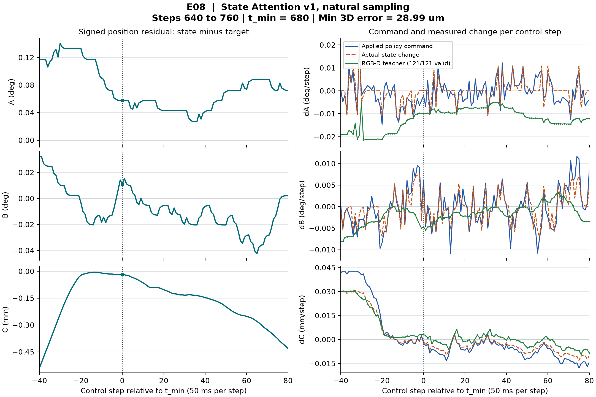
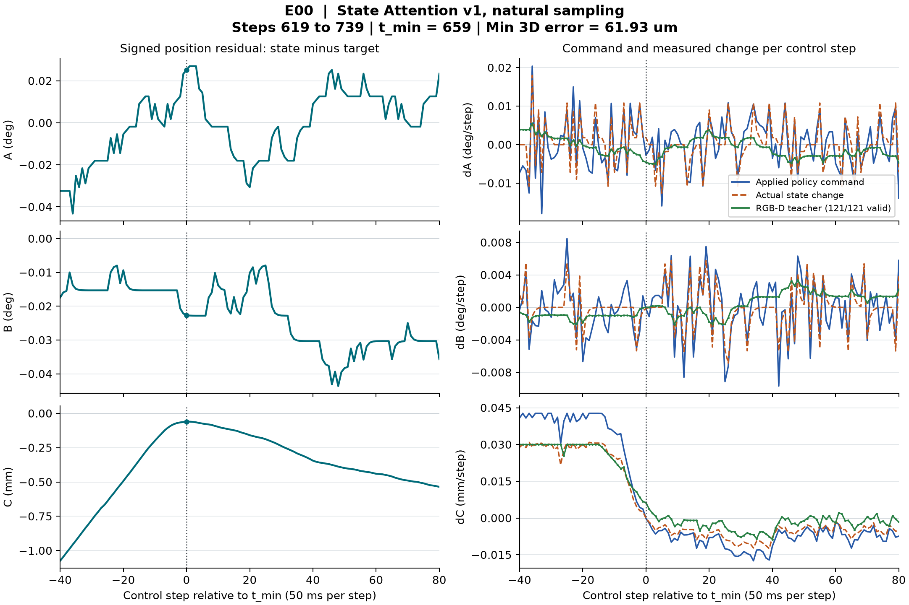
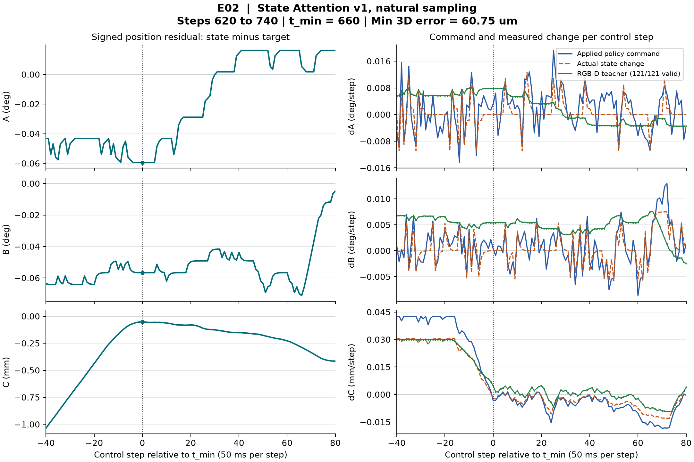
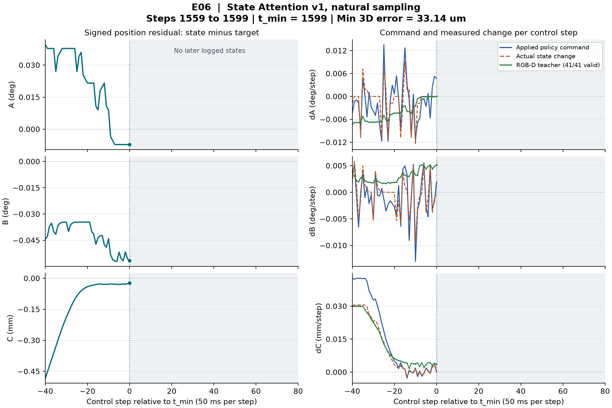

# State Attention v1: axis diagnostics near closest approach

These four plots use the recorded natural-sampling evaluation. `E##` is the
zero-based episode index. Each plot has three rows (A, B, C) and two columns.
The dotted vertical line marks the sampled minimum 3D needle-tip error, and
the horizontal axis shows the offset from that step. A step is 50 ms.

| Episode | `t_min` | Window (step indices) | First sign change in window | A/B/C residual at `t_min` (deg / deg / mm) | First sustained increase in absolute residual |
|---|---:|---:|---|---|---|
| E08 | 680 | 640-760 | B at about -20.6 | +0.05760 / +0.01092 / -0.01858 | C from +0 |
| E00 | 659 | 619-739 | A at about -15.8 | +0.02520 / -0.02262 / -0.06043 | C from +0 |
| E02 | 660 | 620-740 | A at +30 | -0.05940 / -0.05663 / -0.05130 | C from +7 |
| E06 | 1599 | 1559-1599 | A at about -9.3 | -0.00720 / -0.05667 / -0.02320 | No post-minimum series |

The axes do not reach zero together at `t_min` in any of the four episodes.
For E08, E00 and E02, C is the first axis whose absolute residual grows for
eight consecutive control intervals without a reversal (net growth greater
than `1e-5` in axis units; plateaus are allowed). There is no C sign change
in those windows. From `t_min` through the next 80 steps, measured C moves
farther from the target by 0.414 mm, 0.475 mm, and 0.363 mm, respectively.
The applied C command is negative in 77/80, 80/80, and 74/80 intervals.
The independently recomputed teacher also commands some negative increments
under the recorded velocities but has a smaller net negative command in each
window. This points to continued retraction commands as a cause to investigate;
these plots do not establish a motor braking fault or the outcome of a teacher rollout.

The left column subtracts the target task pose decoded from the frozen target
encoder counts. The right column overlays the recorded *applied* policy command
(after clipping and any safety adjustments), the actual next-state difference,
and the one-step strict RGB-D teacher command recomputed at the same pose and
recorded velocity. The teacher was not executed; all 404 recomputed labels
passed its observation checks. At E06 step 1599 the reported post-action terminal
state supplies the last actual delta. There are no later sampled states, so the
rest of E06's requested window is left blank.

[Four-page PDF](axis_diagnostics.pdf) · [Per-step CSV](axis_diagnostics.csv) ·
[Numeric diagnostics and source hash](axis_diagnostics.json)

These are MuJoCo simulation results. See the [natural-sampling evaluation report](../MODEL_STATUS.md).
