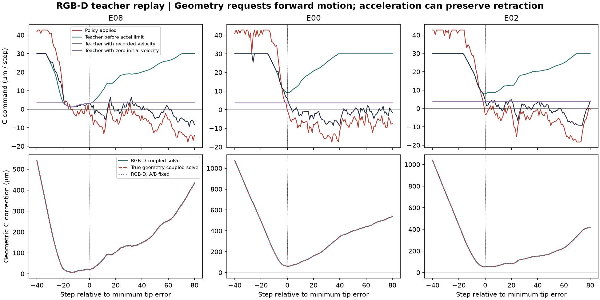
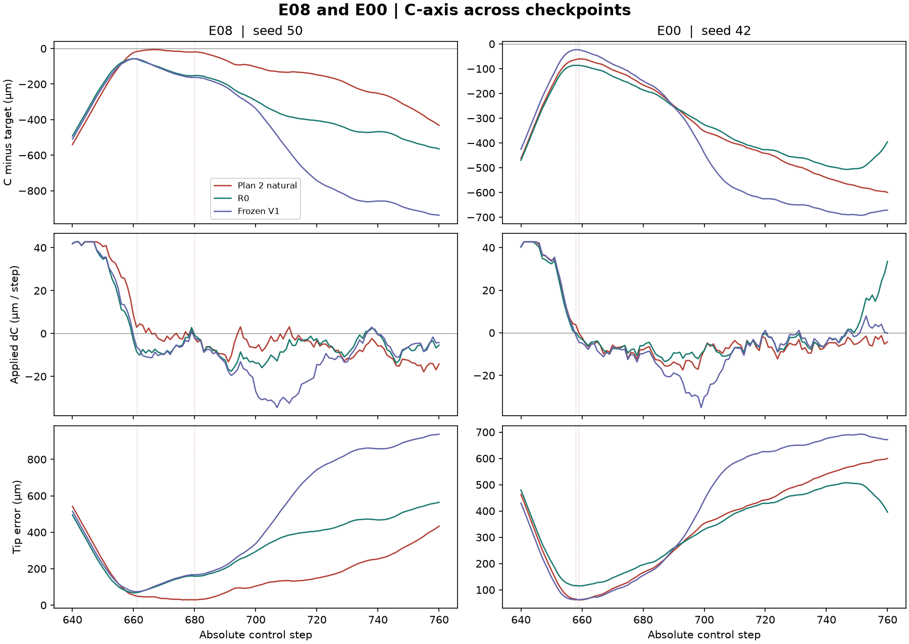
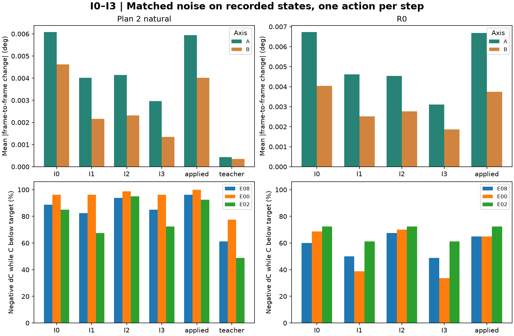

# C 轴回撤诊断：Plan 2、R0 与 Frozen V1

教师在已记录状态上的负 dC 来自限加速度：当针已经往回运动时，教师先制动，单步内仍可能后退。Frozen V1 和 R0 的闭环轨迹已经出现 C 欠插时的持续回撤。Plan 2 的全局负标签比例较高，但这个趋势在近目标分层里反转。推理端的五样本中位数平滑了 A/B，但没有修复 C 的持续回撤。

## 教师为何输出负 dC

`rcm/visual_servo.py:756` 的 `geometry_action_from_observation` 用 RGB-D 重建的目标减针尖三维向量和当前位姿的雅可比矩阵求解。它不读取策略的 OCT 导航向量；得到几何修正后，先限速，再以当前真实速度为中心限加速度，最后检查候选姿态。候选姿态不合法时该标签无效。

对 Plan 2 的 E08/E00/E02/E06，在日志位姿和速度上用 EGL 重算 RGB-D 和标签，404/404 帧有效。E08/E00/E02 各取从轨迹最低点开始的 80 帧，240 帧均欠插。RGB-D 三轴解、真值三轴解、A/B 固定只解 C 和限加速度前的 C 指令均为正。使用原速度时 150 帧教师输出为负，150 帧均触发 C 加速度限制；将原速度置零后 0 帧为负。RGB-D 针尖和目标的位移测量偏差中位数分别为 0.58–0.81 µm 和 9.22–9.55 µm（前三集各自整个窗口），这些偏差未改变上述 240 帧的 C 方向。

| 目标 | 教师负帧 | 策略已执行负帧 | 教师条件指令和 | 策略已执行指令和 |
|---|---:|---:|---:|---:|
| E08 | 49/80 | 77/80 | −0.103 mm | −0.581 mm |
| E00 | 62/80 | 80/80 | −0.167 mm | −0.662 mm |
| E02 | 39/80 | 74/80 | −0.062 mm | −0.511 mm |

教师条件指令和是沿策略产生的状态逐帧重算，不能解释为教师独立闭环的累计位移。E06 的最低点在最后一帧，不能比较最低点之后的行为。

## 标签有没有增加近目标回撤

审计合并训练集的全部 319,697 帧和 `valid_window_indices` 通过的 301,634 个训练窗口起点（两帧观测、16 步动作、50 ms）。近目标分层用有效 OCT 导航向量的范数 `<200 µm`，这是可跨组比较的测量距离，和闭环图上的仿真真值误差不同。下表按 `dC < 0` 统计监督标签；加 0.001 µm 阈值只去掉 1 帧。实际执行动作单列在 CSV。C 目标只由轨迹元数据逆解；原集 193/839 条、Plan 2 200/200 条有元数据。原集缺目标的帧仍参与距离分层，但不用于判断 C 欠插。

| 数据来源 | 全部负帧 | OCT <200 µm 负帧 | OCT <200 µm 且已知 C 欠插 |
|---|---:|---:|---:|
| 原训练集 | 10,365/234,316 (4.4%) | 6,218/33,842 (18.4%) | 3,110/15,605 (19.9%) |
| 原集执行标签 | 6,460/218,433 (3.0%) | 4,154/25,811 (16.1%) | 1,052/7,583 (13.9%) |
| 原集教师标签 | 3,905/15,883 (24.6%) | 2,064/8,031 (25.7%) | 2,058/8,022 (25.7%) |
| Plan 2 全部 | 11,125/85,381 (13.0%) | 10,689/73,501 (14.5%) | 9,342/69,564 (13.4%) |
| D1 | 3,042/22,332 (13.6%) | 2,984/21,693 (13.8%) | 2,898/21,596 (13.4%) |
| D2 | 2,853/14,572 (19.6%) | 2,529/14,160 (17.9%) | 1,929/13,450 (14.3%) |
| D3 | 710/4,429 (16.0%) | 661/4,158 (15.9%) | 0/1,028 (0%) |
| D4 | 4,520/44,048 (10.3%) | 4,515/33,490 (13.5%) | 4,515/33,490 (13.5%) |

按训练窗口起点统计，近目标负标签也是 Plan 2 14.3%、原集 20.3%、原集教师子集 27.4%。新增 Plan 2 帧有 86.1% 在近目标，原集为 14.4%。合并后，近目标负标签的绝对数量增加了，但新增部分的近目标负标签幅值中位数约 1.34 µm/步，原集约 5.52 µm/步。审计支持比较不同状态分布和命令幅值，不能单凭比例推断训练中的因果关系。

## 回撤何时出现

E08/E00 的目标和种子（50/42）经核对相同。绝对第 640–760 步里，Frozen V1 与 R0 都在 C 欠插时持续下发负 dC，回撤早于 Plan 2 数据接入。各轨迹从最低误差帧往后 80 步，C 离目标新增的距离：

| 模型 | E08：最低点步数 / 新增 C 差距 | E00：最低点步数 / 新增 C 差距 |
|---|---:|---:|
| Frozen V1 | 661 / 800 µm | 658 / 644 µm |
| R0 | 1058 / 119 µm | 778 / 71 µm |
| Plan 2 natural | 680 / 414 µm | 659 / 475 µm |

## I0–I3 推理回放

在 R0 `step_004000.pth` 的 703 帧和 Plan 2 `best_model.pth` 的 404 帧上运行四组推理。各组使用同一记录位姿、上一条已执行指令、同源 RGB 和已记录 OCT；速度按两帧位姿差分。每帧共享同一组五份初始高斯噪声，单样本组用第一份，多样本组按轴取中位数。这个诊断只替换当前指令，下一帧依然来自原轨迹。原闭环采用不同的噪声序列，日志里的已执行动作单列，不能和 I0 视为逐帧同一条命令。

| 推理设置 | Plan 2 A/B 平均帧间变化 (°) | R0 A/B 平均帧间变化 (°) | Plan 2 最低点后负 dC | Plan 2 推理中位 / P90 (ms) |
|---|---:|---:|---:|---:|
| I0：4 步，1 样本 | 0.00608 / 0.00463 | 0.00672 / 0.00403 | 216/240 | 8.19 / 8.50 |
| I1：8 步，1 样本 | 0.00402 / 0.00216 | 0.00461 / 0.00252 | 197/240 | 14.47 / 14.91 |
| I2：4 步，5 样本 | 0.00414 / 0.00231 | 0.00454 / 0.00277 | 230/240 | 7.78 / 8.05 |
| I3：8 步，5 样本 | 0.00296 / 0.00134 | 0.00311 / 0.00187 | 203/240 | 14.39 / 14.83 |

A/B 统计的是仿真真值误差均 `<200 µm` 的连续两帧（Plan 2 209 对、R0 359 对），命令已做评估限幅。对应 Plan 2 教师均值是 0.00044° / 0.00035°；最平滑的 I3 仍约为教师的 6.7 / 3.8 倍。I2 比 I0 降低 Plan 2 A/B 的帧间变化 32% / 50%，但增加了 C 回撤频率；I3 在 E00 仍有 77/80 帧回撤，且在最低点后 2 步就出现连续 10 帧负命令。与 I0 相比，I1、I3 让 E02 最低点当帧重新给出正 dC，但 E08/E00 的长回撤仍在。八步组可以作为下一轮闭环对照，当前证据不足以替换默认配置。

计时为 RTX 4090 上的模型前向（含视觉编码、Flow 积分、聚合及首动作回传），不含渲染、感知和电机仿真；各组逐帧顺序相同，毫秒级差异不宜用于判断采样是否提速。这里没有完成《规划3》的每组 20 目标闭环验收，也没有测出新闭环最终误差或停稳率。

[四页 PDF](c_retraction_report.pdf) · [最低点对齐图](c_min_aligned.png) · [阶段指标与 checkpoint SHA-256](results.json) · [轨迹 CSV](c_trace_comparison.csv) · [标签审计 CSV](labels/label_audit.csv)

复核脚本在本地部署目录 `runs/20261119/analysis/c_retraction_20261119_1/`，运行环境为 `.venv`、`MUJOCO_GL=egl`、`MPLBACKEND=Agg`。计算使用记录的 development 轨迹（50 ms，seed `42 + episode_index`）；计数和作图使用 CPU。结果只验证 MuJoCo 仿真内的行为。
